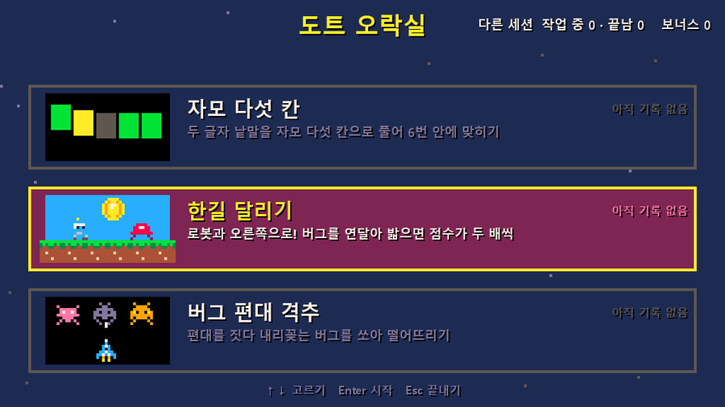
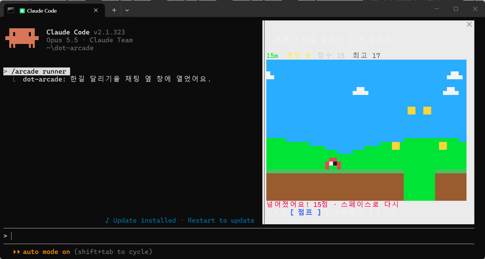
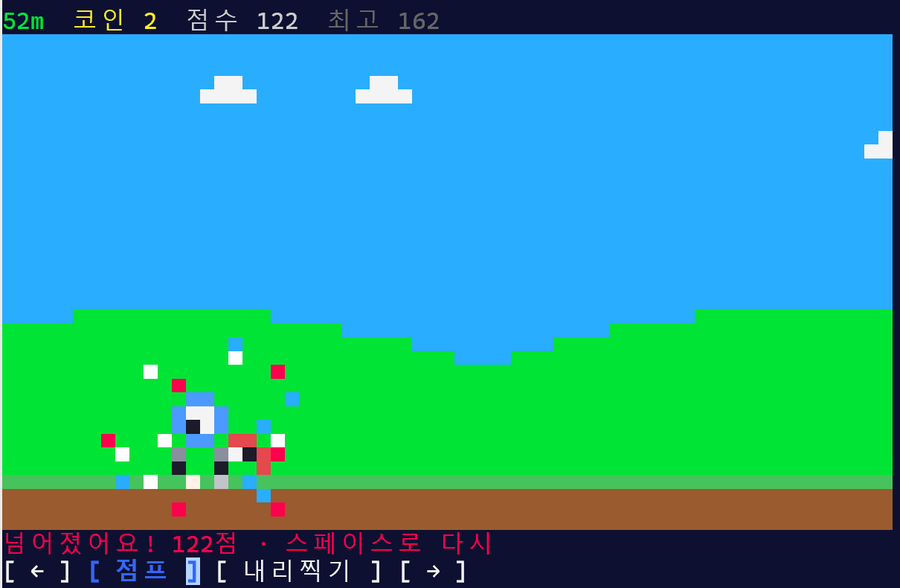
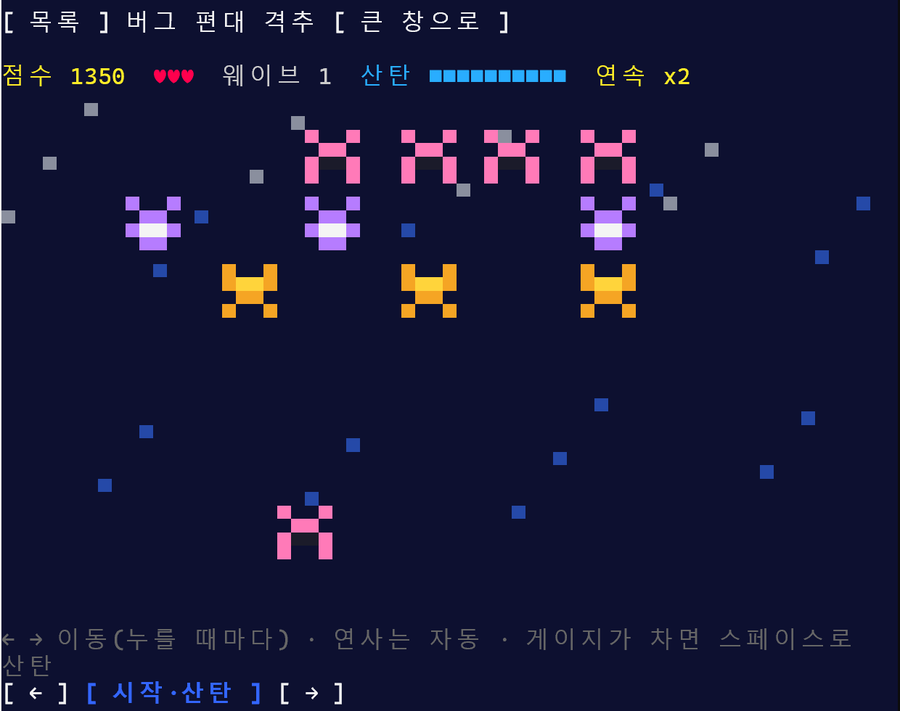
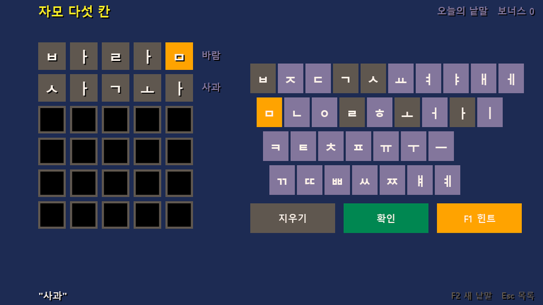
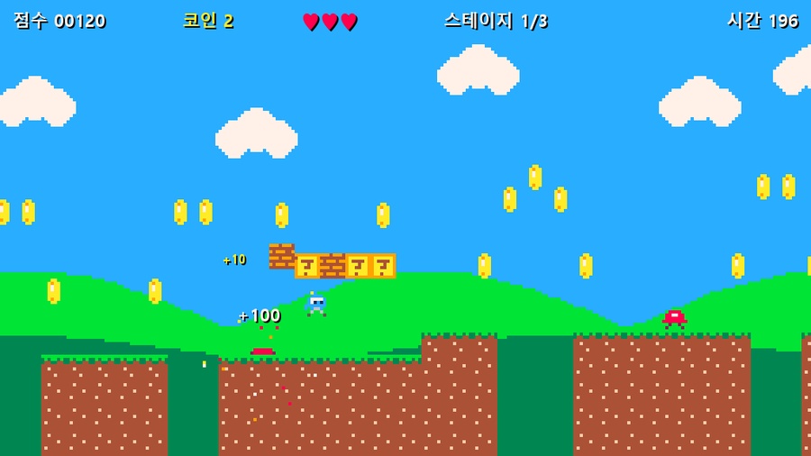
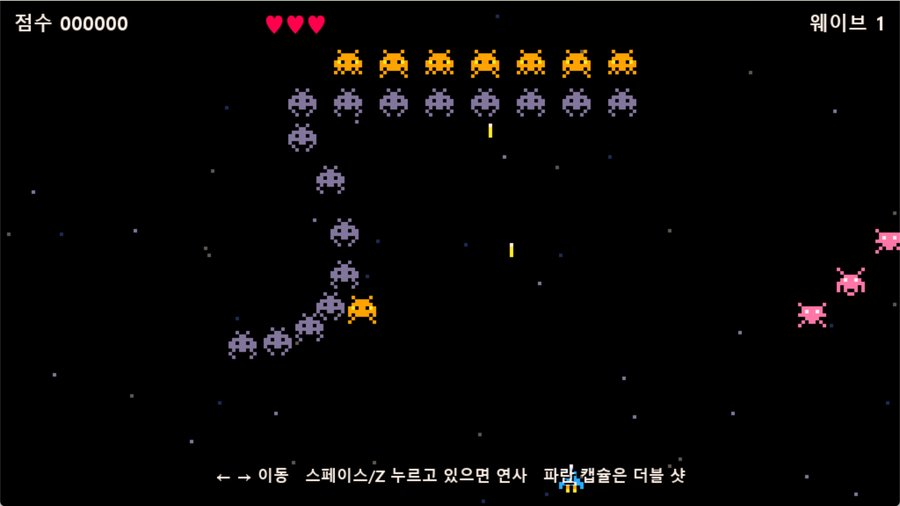

<div align="center">

# 🕹️ 도트 오락실 · dot-arcade

**Claude가 일하는 동안, 당신은 오락실에.**

Claude Code 세션을 여러 개 돌려 두고 기다리는 그 시간,<br>
채팅 바로 옆 창에서 도트 게임 한 판. 다른 세션이 끝나면 게임 안에서 알려 주고 보너스까지.



`Claude Code mod` · `터미널 + 데스크톱 앱` · `게임 3종` · `세션 끝남 알림`

</div>

---

## 이런 겁니다

프롬프트에 `/arcade` 한 줄이면 채팅 옆에 오락실이 붙습니다. 게임은 **그 창 안에서 바로** 돌아가요.



## 게임 3종

<table>
<tr>
<td width="50%" valign="top">

### 🏃 한길 달리기
저절로 달리는 로봇과 끝없이 오른쪽으로.<br>
갈수록 빨라지고, 버그를 **연달아 밟으면 점수가 두 배씩**.

- `스페이스` 점프
- 공중에서 `스페이스` 한 번 더 → **내리찍기**
- 착지 직전에 눌러도, 발판 끝에서 막 떨어져도 점프가 먹힙니다

</td>
<td width="50%"></td>
</tr>
<tr>
<td width="50%" valign="top">

### 👾 버그 편대 격추
휘어 들어와 편대를 짓고, 고리를 그리며 내리꽂는 버그들.<br>
연사는 자동, 당신은 피하고 노리기만.

- `a` `d` 이동 (게임 화면을 클릭하면 `←` `→`도)
- 격추로 게이지를 채우면 `스페이스` **산탄 한 방**
- 연속 격추 배율 최대 x5, 파란 캡슐은 더블 샷

</td>
<td width="50%"></td>
</tr>
<tr>
<td width="50%" valign="top">

### 🔤 자모 다섯 칸
두 글자 낱말을 **자모 다섯 칸**으로 풀어 6번 안에 맞히기.<br>
예: 사과 → `ㅅ` `ㅏ` `ㄱ` `ㅗ` `ㅏ`<br>
겹자모도 모두 기본 자모로 풉니다: 까치 → `ㄱ` `ㄱ` `ㅏ` `ㅊ` `ㅣ`, ㅐ → `ㅏ` `ㅣ`, ㅔ → `ㅓ` `ㅣ`

- 🟩 자리까지 맞음 · 🟧 있지만 자리 다름 · ⬛ 없음
- 칸이 하나씩 뒤집히고, 맞히면 **색종이가 터집니다** 🎉
- 매일 바뀌는 오늘의 낱말 + 무제한 연습 판

</td>
<td width="50%"></td>
</tr>
</table>

## 어디서 되나요

| 어디서 | 자모 다섯 칸 | 달리기, 격추 |
| --- | --- | --- |
| 터미널의 `claude` (Windows Terminal, iTerm, Orca 같은 앱 안 터미널 포함) | ✅ | ✅ |
| Claude 데스크톱 앱 (Code 탭) | ✅ | ✅ |
| VS Code 확장 | ✅ | 큰 창으로 |
| 모바일 앱 | 화면 자판으로 | ❌ |

달리기와 격추는 실시간으로 그리는 칸이 있는 곳(터미널, 데스크톱 앱)에서만 돌아갑니다.

## 다른 세션이 끝나면

이 mod가 켜진 세션들은 서로의 상태를 압니다. 오락실 창 맨 위에 **"다른 세션 작업 중 2 · 끝남 1"**이 뜨고, 기다리던 세션이 끝나는 순간 알림과 함께 **보너스 +1**.

| 보너스로 | |
| --- | --- |
| 🏃 한길 달리기 | 한 번 막아 주는 방패 |
| 👾 버그 편대 격추 | 목숨 +1 |
| 🔤 자모 다섯 칸 | 한 칸 힌트 |

## 설치

Claude Code 터미널에서:

```
/plugin install dot-arcade --marketplace dlsxody1/dot-arcade
```

셸에서:

```bash
claude plugin install dot-arcade --marketplace dlsxody1/dot-arcade
```

데스크톱 앱: 프롬프트 옆 **+** → **Plugins** → **Add marketplace**에 `dlsxody1/dot-arcade` → **Add plugin**.

> Claude Code **v2.1.287 이상**(데스크톱 앱은 v2.1.286 이상)에서 mod가 돌아갑니다. 설치 뒤 이미 열린 세션은 `/reload-plugins` 한 번.

## 하는 법

```
/arcade            게임 고르기
/arcade runner     한길 달리기 바로 시작
/arcade shooter    버그 편대 격추 바로 시작
/arcade jamo       자모 다섯 칸 바로 시작
```

- ⌨️ 게임을 열면 키는 처음부터 화면 아래 **키 칸**으로 들어갑니다. 채팅 입력칸으로 새지 않아요. `Esc`를 누르면 프롬프트로 돌아갑니다.
- 🔤 **한/영을 끄고** 치세요. 달리기는 `스페이스`, 격추는 `a` `d`로 움직이고 `스페이스`로 산탄. 자모 다섯 칸은 두벌식 자리로 치면(`a` → ㅁ) 누르는 순간 칸에 찍혀요.
- 🖱️ 방향키를 쓰고 싶으면 게임 화면을 한 번 클릭하세요. 화면 버튼과 자판을 눌러도 키는 다시 키 칸으로 돌아옵니다.

> 💡 터미널은 키를 *뗀* 것을 알려 주지 않아서, 터미널판은 **누르기만으로** 재밌게 만들었습니다. 길게 누르기 점프와 60fps가 그립다면 아래 큰 창으로.

## 🖥️ 큰 창으로 (선택)

게임 화면의 **[큰 창으로]** 버튼을 누르면 따로 뜨는 pygame 창에서 같은 게임을 할 수 있습니다. 키 누름과 뗌을 모두 알아서 길게 누르면 높이 뛰고, 60fps로 부드럽게 돌아가요.

<p>


</p>

필요한 것: **Windows**, **Python 3.12**, pygame-ce

```bash
pip install pygame-ce
```

## 기록

내 최고 기록과 보너스는 내 PC에만 남습니다.

```
~/.claude/dot-arcade/records.json   게임별 최고 점수, 날짜, 판 수
~/.claude/dot-arcade/bonus.json     보너스 개수
~/.claude/dot-arcade/sessions/      세션마다 작업 중/끝남
```

## 만든 방법

- mod: TypeScript 훅 모듈 하나(`plugins/dot-arcade/hooks/register.tsx`)와 게임별 `Client` 모듈. 도트는 반칸 블록(`▀`) 한 칸에 픽셀 두 개.
- 연출: 화면 흔들림(trauma²), 맞을 때 잠깐 멈춤, 늘었다 줄기, 파티클, 점수 팝, 번쩍임(초당 3회 이하).
- 점프 수치와 연출은 저장소의 `.claude/skills/`(platformer, game-feel)를 따랐습니다. 출처와 바꾼 곳은 각 폴더의 `SOURCE.md`.
- 그림, 캐릭터, 이름은 모두 새로 만든 것입니다.

```bash
claude plugin validate plugins/dot-arcade       # mod 검사
claude plugin test plugins/dot-arcade           # mod 테스트
python -m pytest plugins/dot-arcade/game/tests  # 큰 창 규칙 테스트
```

## 라이선스

MIT. `.claude/skills/` 아래 스킬은 각 폴더의 원본 라이선스(Apache-2.0, MIT)를 따릅니다.
